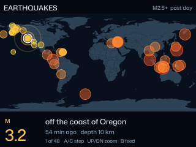

# badgeware

Apps for the [Pimoroni Badgeware Tufty 2350](https://shop.pimoroni.com/products/tufty-2350)
badge. Two pull live data over WiFi, two scan for the WiFi networks and Bluetooth devices around you, one watches for
signs of common WiFi attacks, and the
others are name badges built around your own logo.
All draw on the badge's full 320x240 screen.

Also here: a drop-in `secrets.py` that takes a **list** of WiFi networks instead of a
single one, so the badge connects on whichever is in range — see
[More than one WiFi network](#more-than-one-wifi-network).

Written and tested on Tufty firmware v3.1.1.

## Apps

### Planes Overhead

A radar scope of the aircraft flying near you right now: a rotating sweep, range
rings, and a marker for each aircraft pointing along its heading. A side panel
shows the selected aircraft's callsign, type, altitude, speed, distance, bearing
and heading.

| Button | Action |
|---|---|
| A / C | Step through aircraft, nearest first |
| UP / DOWN | Change range (10, 25, 50, 100 nm) |
| B | Toggle callsign labels |

- Aircraft positions come from [adsb.lol](https://adsb.lol) every 20 seconds.
  Between fetches each marker keeps moving along its last reported track.
- The badge works out roughly where it is from its internet address, using
  [ip-api.com](https://ip-api.com). To pin an exact position instead, add
  `LATITUDE` and `LONGITUDE` to `secrets.py` on the badge.
- adsb.lol asks every client to identify itself with a contact detail. **Change
  the `HEADERS` line near the top of `planes_overhead/__init__.py` to your own
  contact before you use it.**

### Earthquakes

Recent earthquakes from the [USGS](https://earthquake.usgs.gov/earthquakes/feed/)
plotted on a world map, sized and coloured by magnitude. The bar underneath shows
the selected quake's magnitude, place, age and depth.



| Button | Action |
|---|---|
| A / C | Step through quakes, newest first |
| UP / DOWN | Zoom in on the selected quake |
| B | Switch feed (M2.5+ past day, M4.5+ past week, significant past month) |

- The feed refreshes every five minutes.
- The map is the `world.geo.json` that ships with the stock firmware.

### Logo Badge

A three-page name badge built around your own logo or picture: the art with a
name plate, a page of your social accounts, and a QR code.


| Button | Action |
|---|---|
| A | Previous page |
| C or B | Next page |

To make it yours:

- Edit the name, role, accounts and QR address at the top of
  `logo_badge/__init__.py`. The accounts can be any of the services with an icon
  in `logo_badge/assets/socials`.
- Replace the placeholder art by running `python logo_badge/make_assets.py
  your-picture.png` on your computer (needs Pillow). It fits the picture above
  the name plate and builds the dimmed copy used behind the other pages.
- The QR code is generated on the badge, which needs firmware v3.1.0 or newer.

The social icons come from Pimoroni's stock badge app and are MIT licensed; see
`logo_badge/assets/socials/LICENSE`.

### Ham Badge

A single-page amateur-radio name badge, built from Logo Badge: the club logo in a
panel on the left, your name on the right, and your callsign across the bottom in
large white letters, with a slash drawn through the zero, ham style.

To make it yours:

- Edit `callsign` and `name_lines` at the top of `ham_badge/__init__.py`.
- Rebuild the background and launcher icon from your own logo by running `python
  ham_badge/make_assets.py your-logo.png` on your computer (needs Pillow). It fits
  the logo into the left panel on a black field and shrinks a copy for the icon.

### WiFi Scanner

Lists the WiFi networks in range, adding each one as the badge finds it. Each row
shows signal bars, the network name, its security, channel and signal strength
in dBm. Newly found networks get a fading blue marker on the left; networks that
have not been heard for three scans are greyed out but kept on the list.

| Button | Action |
|---|---|
| UP / DOWN | Move through the list |
| C | Details for the selected network (BSSID, best signal, first and last seen) |
| B | Sort by newest (first found), latest (most recently heard), signal or channel |
| A | Pause or resume scanning |

- Scans run back to back with a two-second gap. Each scan takes a couple of
  seconds, during which the screen holds still.
- The badge's radio is 2.4 GHz only, so 5 GHz and 6 GHz networks don't appear.
- The badge's WiFi driver (firmware v3.1.1) only reports whether a network is
  open, WEP, WPA or WPA2-style. WPA3 and enterprise networks show as WPA2.
- Nothing is saved; the list starts empty each time the app opens. It doesn't
  need `secrets.py` or a WiFi connection.

### Bluetooth Scanner

Lists the Bluetooth Low Energy devices advertising nearby, adding each one as the
badge hears it. Each row shows signal bars, the device's name (or what kind of
device it is, or its address), the maker, and signal strength in dBm. New devices
get a fading marker; devices not heard for 30 seconds are greyed out but kept.

| Button | Action |
|---|---|
| UP / DOWN | Move through the list |
| C | Details: address, maker, type, advertised services, connectable, TX power, first and last heard |
| B | Sort by newest (first heard), latest (in range by signal, then most recently gone), signal or name |
| A | Pause or resume scanning |

- Scanning runs continuously in the background, so unlike the WiFi Scanner the
  screen never pauses.
- Only Bluetooth Low Energy: MicroPython doesn't support classic Bluetooth, so
  older audio devices and the like won't show unless they also advertise over BLE.
- Phones, watches and trackers mostly use random addresses that change every few
  minutes, so one phone can show up as several devices over time.
- The types for Apple devices (Find My, AirPods, Handoff and so on) come from
  public reverse engineering of Apple's advertisements, not from Apple, so treat
  them as best guesses.
- Nothing is saved.

**Maker names.** The app turns the manufacturer ID in each advertisement into a
company name using the Bluetooth SIG's list of company identifiers. That list
isn't included here. Build it before copying the app to the badge:

```
python bluetooth_scanner/make_companies.py
```

This downloads the list and writes `bluetooth_scanner/assets/companies.bin`
(about 130 KB, roughly 4,000 companies). Without it the app still runs, naming a
few common makers and showing the rest as a hex ID.

### Wifi Watch

Run it when WiFi feels off. It repeatedly scans and probes the air around you
and shows a green, amber or red status, with one line per check. A red status
also pulses the badge's case lights. Warnings stay on screen after the cause
goes away, marked with how long ago they happened, until you clear them.

| Check | What it looks for |
|---|---|
| Fake-network probe | Asks for made-up network names that can't exist. An access point that answers is saying yes to every name, which is what KARMA-style rogue APs such as a WiFi Pineapple do. |
| Security downgrade | The same network name broadcast both encrypted and open (or WEP), or your own secured network showing up as open. |
| Evil twin | Your networks (the ones named in `secrets.py`) coming from an access point the badge hasn't learned, changing security, or suddenly far stronger than usual. |
| Beacon flood | A sudden jump in the number of networks, or a burst of brand-new ones in one scan. |
| Connection drops | The badge joins your network and counts unexplained drops. Repeated drops are the main symptom of a deauthentication attack. |
| Portal / DNS | While joined, checks that a well-known name doesn't resolve to a private address and that Google's connectivity check isn't redirected. |

| Button | Action |
|---|---|
| A | Clear warnings |
| B, then B again | Learn the access points of your networks that are in range now |
| C | Warnings seen this session |
| UP / DOWN | Scroll the warnings |

- **Learn on a network you trust.** The evil-twin check compares against what
  you learned. Do it once at each place you use (home, work); each network's
  list is replaced only when it's in range. An open copy of a secured network
  is never learned. The list is kept in `/state/wifi_watch.json` on the badge.
- **What it can't see.** The badge can't capture raw WiFi frames, so it can't
  see deauthentication or disassociation frames, handshake or PMKID capture,
  or anyone passively listening. It infers deauth attacks from connection
  drops. It also only covers 2.4 GHz.
- **WPA3 looks like WPA2.** The firmware doesn't tell WPA2, WPA3 and enterprise
  apart, so a WPA3 network dropped to WPA2 isn't caught. Downgrades to open or
  WEP are.
- **False alarms happen.** A new mesh node or a neighbour using the same network
  name looks like an unknown access point (amber, not red). Phone hotspots and
  busy venues can trip the beacon flood check. A DNS filter such as Pi-hole
  that answers 0.0.0.0 shows as amber.
- The connection checks need `secrets.py` and are skipped without it. The DNS
  and connectivity check contact `connectivitycheck.gstatic.com` and
  `example.com` once a minute. Nothing else is saved.

## More than one WiFi network

The stock firmware reads a single `WIFI_SSID` and `WIFI_PASSWORD` from
`secrets.py`. `extras/multi_wifi_secrets.py` is a drop-in replacement that takes
a list of networks instead: whenever an app loads it, the badge scans for what is
in range and uses the first listed network it can see. Every app, stock or from
this repo, then connects without any changes.

1. Fill in your networks, region and timezone in `extras/multi_wifi_secrets.py`.
2. Put the badge into disk mode and copy the file to the root of the drive as
   `secrets.py`, replacing the one that is there.
3. Eject, then press RESET.

- The scan adds a little over a second to starting any app that reads `secrets.py`.
- If none of the listed networks is in range, the badge tries the first one in the list.
- Reflashing the badge with a "with-filesystem" firmware image resets `secrets.py`.

Keep your filled-in copy out of any public repository; it holds your WiFi passwords.

## Installing

1. Set your WiFi details in `secrets.py` on the badge, if you haven't already — or use
   the multi-network replacement from [More than one WiFi network](#more-than-one-wifi-network).
2. Put the badge into disk mode (double-press RESET).
3. Copy the app's folder (`planes_overhead`, `earthquakes`, `wifi_scanner`, `bluetooth_scanner`, `wifi_watch`, `logo_badge` or `ham_badge`) into `apps` on the badge.
4. Eject the drive and wait for it to finish, then press RESET.

Always eject before resetting or unplugging. The badge's drive is easily
corrupted if it disappears while the computer is still writing to it.

## Icons

`make_app_icons.py` draws the 24x24 launcher icons from character grids, so they
can be edited pixel by pixel. It needs Pillow (`pip install pillow`).

## Data sources

Check each provider's terms before building on these apps.

- [adsb.lol](https://adsb.lol) for aircraft positions
- [ip-api.com](https://ip-api.com) for approximate location (free for non-commercial use)
- [USGS Earthquake Hazards Program](https://earthquake.usgs.gov/earthquakes/feed/) for earthquakes
- [Bluetooth SIG assigned numbers](https://bitbucket.org/bluetooth-SIG/public/src/main/assigned_numbers/) for Bluetooth company identifiers and service UUIDs

## License

GPL-3.0. See [LICENSE](LICENSE).
